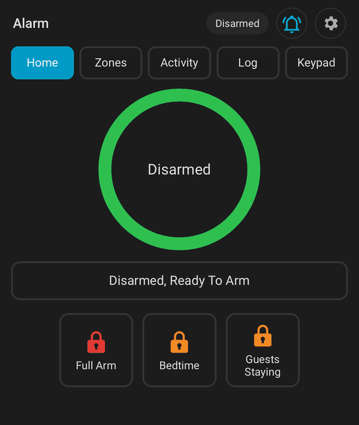
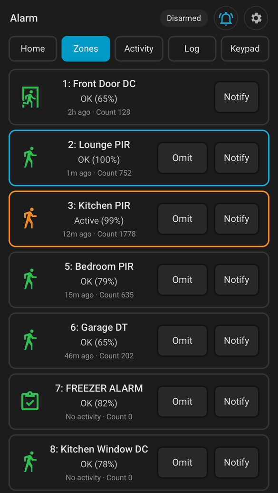
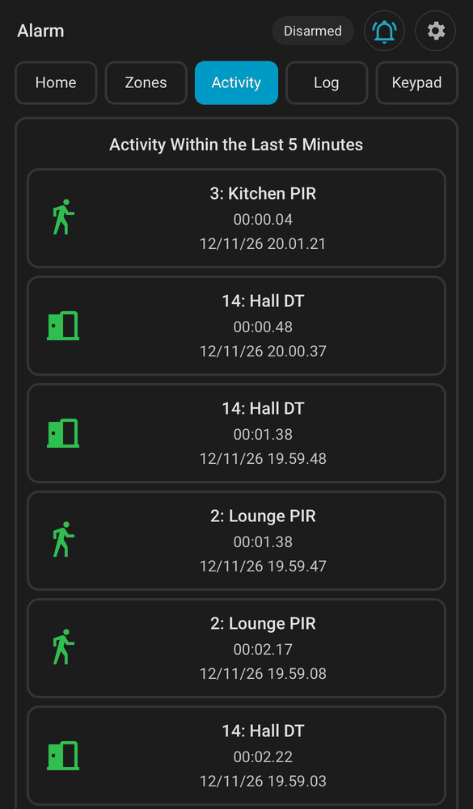
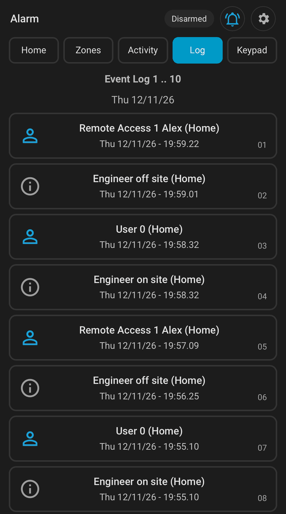
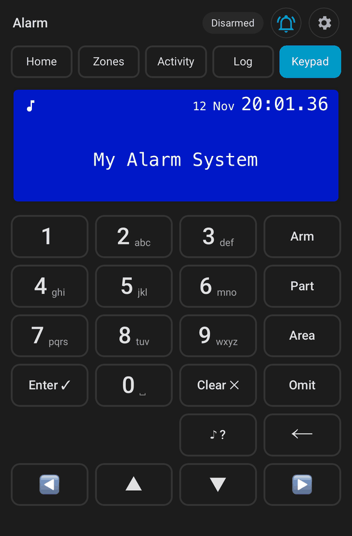

# Orisec for Home Assistant (unofficial)


A local Home Assistant integration for **Orisec intruder alarm panels**, with a full keypad card laid out like the ControlPlus app. Nothing goes through the cloud: Home Assistant talks to the panel directly over USB, the CM2 network module, or a serial bridge (for example an ESP32).

> **Unofficial.** This project has no connection with Orisec Ltd and isn't endorsed or supported by them. "Orisec" and "ControlPlus" are Orisec's names, used here only to say which panels this works with. Don't contact Orisec or your installer about this integration; [open an issue](../../issues) instead.

> **Status: 0.4.0, early public release.** Used daily on a CP50 (firmware 9.10). Other panels and firmware are untested: reports welcome.

## Screenshots

| Home | Zones | Activity | Log | Keypad |
|---|---|---|---|---|
|  |  |  |  |  |

## What you get

- **Alarm panel** per area your user code controls: full set, part sets 1–3 (labelled with your panel's own part-set names), disarm, and live *arming*, *entry* and *triggered* states.
- **Zone sensors** named from the panel (**Healthy / Active**), with `zone_type`, `areas`, `tamper`, `omitted`, `can_omit`, `since` and `activations` attributes. *Not Used* and keyswitch zones are skipped.
- **Wireless zones**: temperature, battery, signal (both directions on two-way devices) and time since last poll for each wireless device.
- **Network devices** (keypads, wireless expanders, external sounders): each is its own device, with light level, voltage, current and comms error counts; sounders also report their own battery.
- **Panel power** and **fault sensors**: supply and battery voltage, currents, mains fault, battery fault, tamper, trouble, engineer required.
- **Keypad display** sensor (the live LCD) and an `orisec.send_key` action.
- **Keypad card**: Home (areas, Full / part sets / Disarm / Quick Arm / Reset), Zones (status, signal, Omit, Notify), Activity, Log (the panel's event log) and Keypad (every key and the live LCD with status icons).
- **Per-user PIN** (optional): arm, disarm, reset and omit as a particular panel user, so the panel's log shows who did it. Each phone or wall screen chooses No PIN / Ask / Remember.
- **Per-user notifications** to each HA user's phones, sorted into the same categories as the app, with areas, zones and critical alerts. An `orisec_event` is fired for every new log entry, for your own automations.
- **Panel clock**: an offset sensor, a *Sync panel clock* button and `orisec.set_clock` action, and optional automatic sync.
- **Zone omit / reinstate** and the **event log** using the panel's own commands.
- **Reliability**: if the panel stops answering, entities go *unavailable* within about 10 seconds rather than showing a stale state, and the integration logs back in by itself.
- **Reconfigure**, **re-authenticate** and **diagnostics** download (codes, addresses and the panel serial are redacted).

### What it deliberately doesn't do

- **No panic / PA.** Not on the card and not available as an action.
- **No engineer access or programming.** It logs in with an ordinary user code and can only do what that user can do at a keypad.
- **No output control** and **no panel restart**.

## Requirements

- An Orisec panel with ControlPlus firmware. Tested: **CP50, firmware 9.10**.
- A **user code** for the panel (not the engineer code). Make a dedicated user for Home Assistant if you can, so the panel's log shows what HA did.
- One of the three connections below.
- Home Assistant **2026.3** or newer (for the integration icon; older versions work without it).

## Install

### HACS (recommended)

1. HACS → ⋮ → **Custom repositories** → add `https://github.com/FarmerJack69/HA-Orisec`, type **Integration**.
2. Install **Orisec (unofficial)** and restart Home Assistant.
3. **Settings → Devices & services → Add integration → Orisec**.

### Manual

Copy `custom_components/orisec` into your HA `config/custom_components/` folder and restart.

## Connecting to the panel

Pick a connection when you add the integration. All three carry the same messages, so every feature works on every link, and you can switch later with **Reconfigure** (entities keep their IDs).

| Type | What you need | Notes |
|---|---|---|
| **USB** | A micro-USB data cable from the panel PCB to the HA machine | The panel appears as an STM32 Virtual ComPort (`/dev/serial/by-id/usb-STMicroelectronics_STM32_Virtual_ComPort_...`). Baud rate doesn't matter. The simplest if HA is near the panel. |
| **Network** | A CM2 module with a static IP | Port 20202 by default. Some CM2s stop answering until the panel's network settings are saved again; USB or the bridge avoid this. |
| **Serial bridge** | An ESP32 (or ser2net) on a panel COM port | Port 6638 by default. Ready-made ESPHome config and wiring: [`esphome/`](esphome/README.md). Set the COM port to **Mode 0**, 115200 baud. |

Only one client at a time on a link: close UDL or anything else talking to the same port.

## Keypad card

The integration loads the card itself, with its version in the address, so after an update a normal refresh of the browser or app is enough. You don't need a dashboard resource for it; if you added `orisec-keypad-card.js` under **Settings → Dashboards → ⋮ → Resources** for an earlier version, remove it.

```yaml
type: custom:orisec-keypad-card
entity: sensor.orisec_cp50_keypad_display
title: Alarm
# optional: view, tabs, recent_minutes, pin (device|none|ask|remember), notify (false hides the bell)
```

The entity name depends on your panel model. Areas, zones and buttons are found automatically.

## Reporting a problem

Please open an issue with:
- your panel model and firmware (shown on the panel device in HA),
- the connection type,
- the **diagnostics** file (Settings → Devices & services → Orisec → ⋮ → Download diagnostics), which has codes, IP addresses, the serial number and area names removed. Check it before posting anyway: zone names stay in.

**Never post packet captures or your codes.**

## Security

The panel's local protocol isn't encrypted. Anyone who can capture traffic between a client and the panel can read codes, so keep the panel (and any bridge) on a trusted network. Anyone with access to your Home Assistant can arm and disarm through this integration, the same as with the official app, so treat HA accounts accordingly.

## Development

| Path | What it is |
|---|---|
| `custom_components/orisec/protocol.py` | Pure-Python protocol library (no HA imports) |
| `custom_components/orisec/client.py` | Async client (UDP, USB serial, TCP bridge) |
| `custom_components/orisec/coordinator.py` | Polling, config load, re-login |
| `custom_components/orisec/notifications.py` | Per-user notification settings and sending |
| `custom_components/orisec/frontend/` | Keypad card |
| `esphome/` | ESP32 serial bridge config and setup guide |
| `tests/` | Tests |

```
pip install pytest
pytest
```

## Credits

- [iamacarpet/homeassistant_orisec](https://github.com/iamacarpet/homeassistant_orisec) by Samuel Melrose (MIT), whose protocol work this was cross-checked against. No code was copied; this integration was written from scratch.
- Early protocol notes from [nmc888/Orisec2MQTT](https://github.com/nmc888/Orisec2MQTT).

## Licence

MIT. See [LICENSE](LICENSE).
